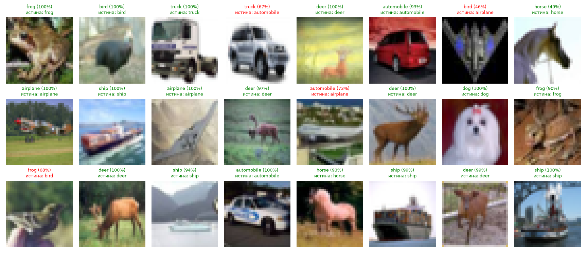
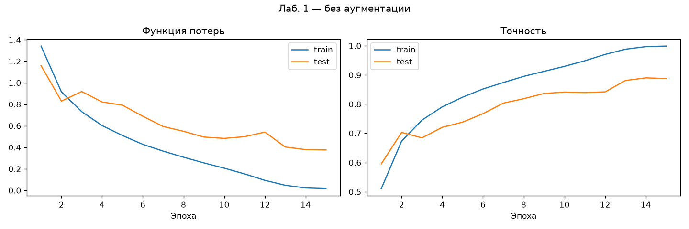
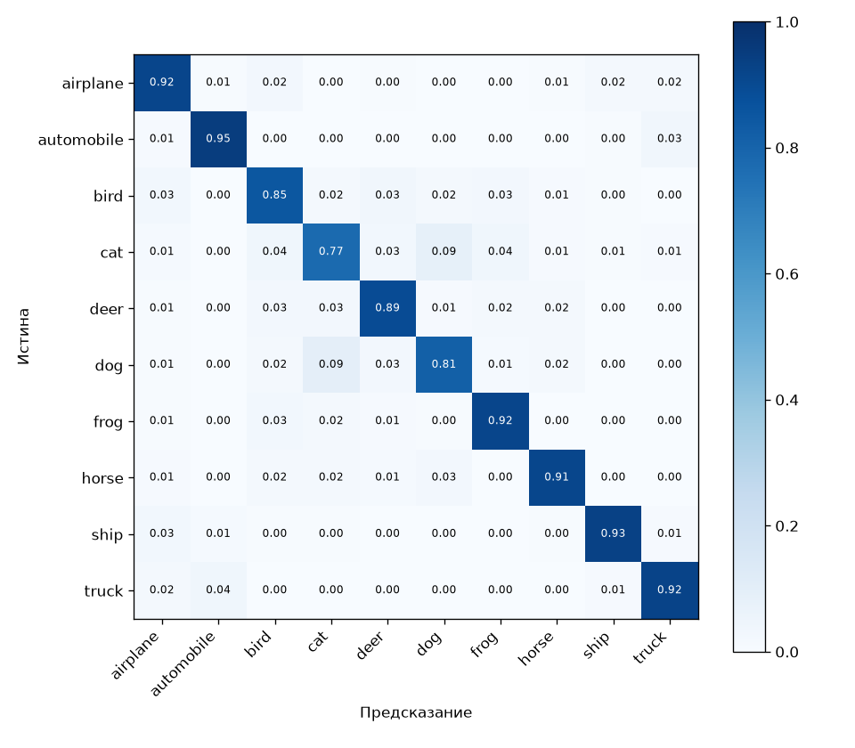
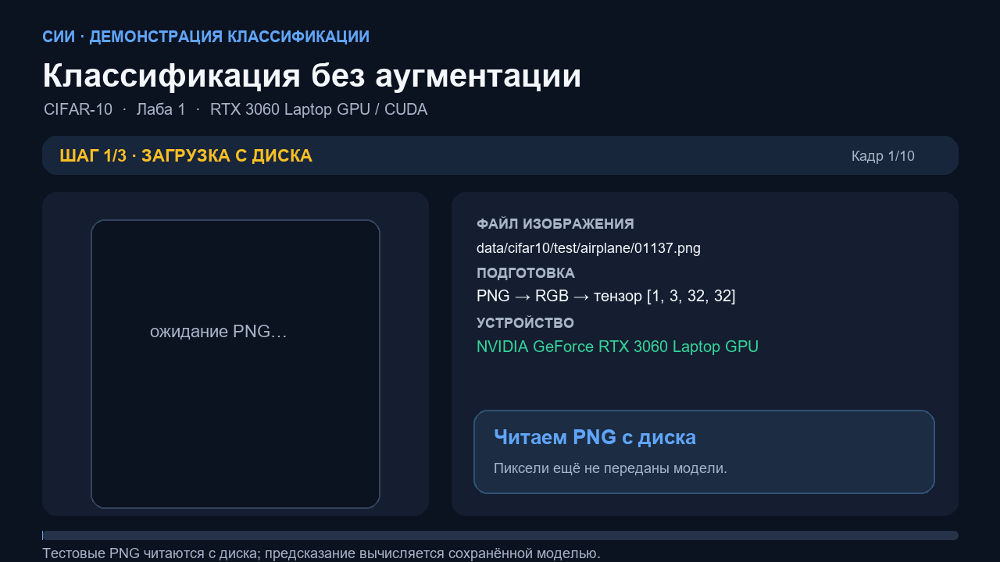
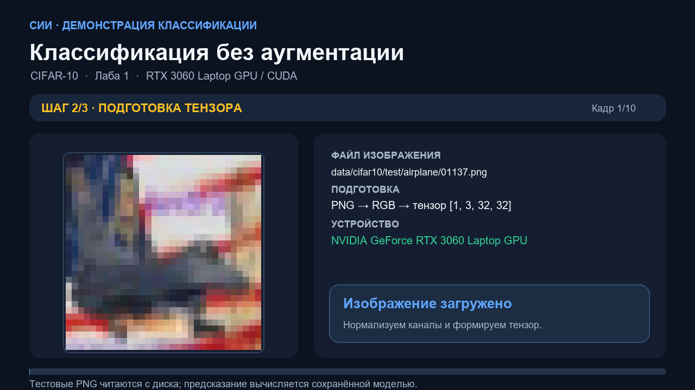
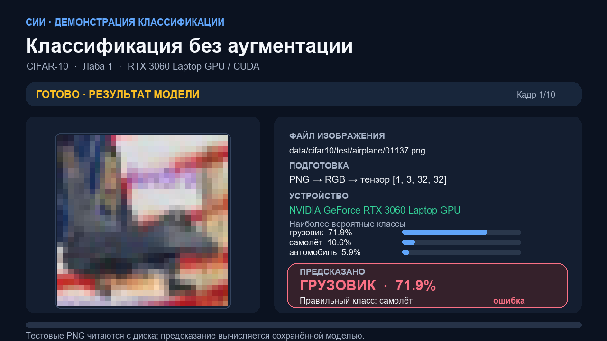

# Отчёт по лабораторной работе 1

**Выполнил:** студент группы ИВТИИбд-41 Валиуллов Р.Р.

## Тема и цель

**Классификация изображений глубокой нейронной сетью.** Цель — обучить CNN распознавать один из десяти классов CIFAR-10 и визуально оценить её предсказания.

## Данные и метод

CIFAR-10: 50 000 изображений в обучающем наборе и 10 000 в тестовом, 10 категорий, размер 32×32 RGB. Изображения хранятся в `data/cifar10/` и загружаются с диска через `ImageFolder`. Модель — VGG-подобная CNN из 1 148 874 параметров. Обучение: PyTorch 2.14.1+cu126 на RTX 3060 Laptop GPU, CUDA AMP, batch size 128, SGD с Nesterov и OneCycleLR, 15 эпох.

## Результаты

Итоговая test accuracy — **0,8877 (88,77%)**. Лучшие классы: automobile 0,948 и ship 0,932. Самый сложный класс — cat (0,774). Train accuracy достигла 0,999, что показывает переобучение; test accuracy осталась ниже. В сетке предсказаний есть и правильные ответы (зелёные подписи), и ошибки (красные подписи).

| Метрика | Значение |
|---|---:|
| Точность на тесте | 0,8877 |
| Train accuracy на последней эпохе | 0,9988 |
| Число параметров | 1 148 874 |
| Эпохи | 15 |
| Время эпох по логу | 9 мин 33 с |

## Визуальные результаты

### Примеры классификации

### Динамика обучения и матрица ошибок

## Видео и скриншоты демонстрации

Видеоролик показывает 10 тестовых PNG, по одному изображению каждого класса: чтение файла с диска, подготовку тензора, вычисление модели на CUDA и реальный ответ с уверенностью. В ролике оставлены и ошибки модели: например, первый самолёт классифицирован как грузовик. Сцены загрузки и подготовки оформлены как равномерные экранные кадры; значения и метки взяты из реального инференса сохранённой модели. Это презентационная демонстрация пайплайна, а не необработанная запись всего рабочего стола.

[Скачать/открыть видео MP4 (46 секунд)](../медиа/лаба1_загрузка-и-распознавание.mp4)

Для показа на другом компьютере распакуйте пакет целиком и откройте `отчеты/медиа/демо.html` в браузере. Для этого Python и интернет не нужны.

<video controls width="960" poster="../медиа/скриншоты/лаба1/03_предсказание.png"><source src="../медиа/лаба1_загрузка-и-распознавание.mp4" type="video/mp4"></video>

Дополнительные скриншоты этапов загрузки и подготовки: `отчеты/медиа/скриншоты/лаба1/`.

## Вывод

CNN научилась различать большинство объектов CIFAR-10 и достигла 88,77% точности. Наиболее часто ошибки возникают между визуально похожими категориями. Разница между почти идеальной train accuracy и более низкой test accuracy указывает на переобучение и мотивирует сравнение с аугментацией в следующей работе.

## Файлы результата

`lab1/results/` содержит `model.pt`, `metrics.json`, `predictions.png`, `confusion_matrix.png` и `history.png`. Журнал обучения — `lab1/train.log`.

