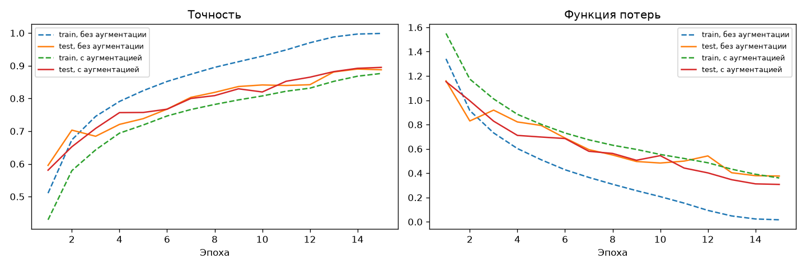
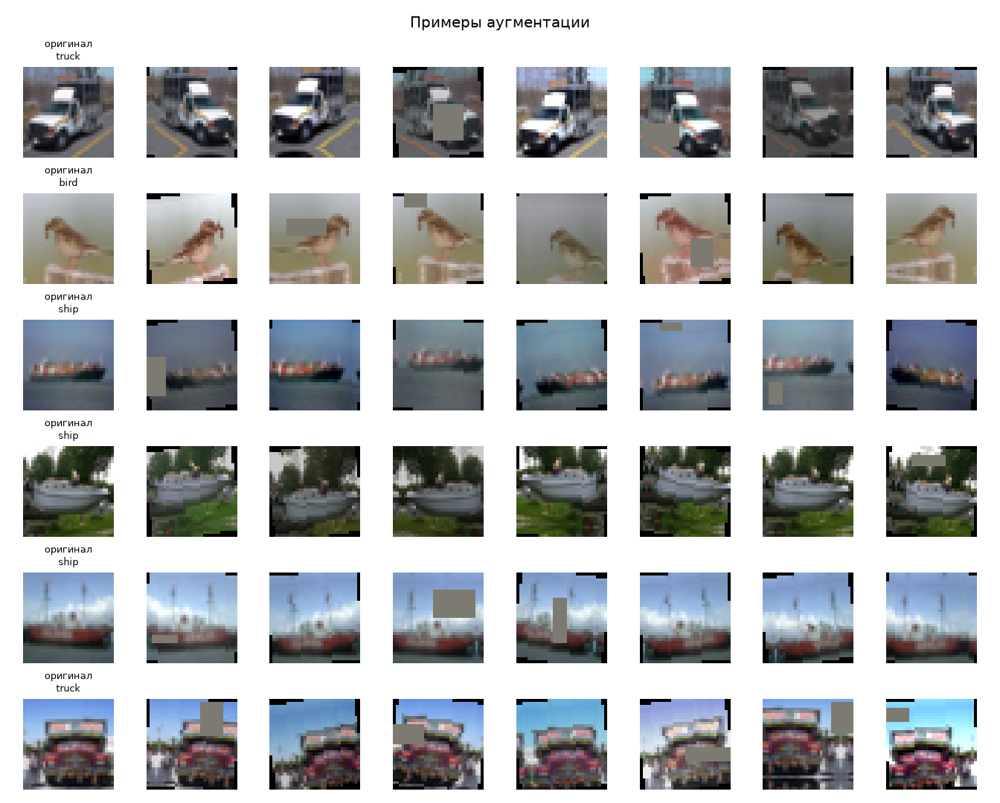
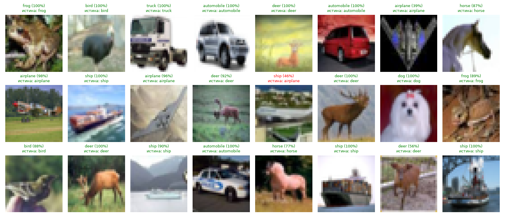
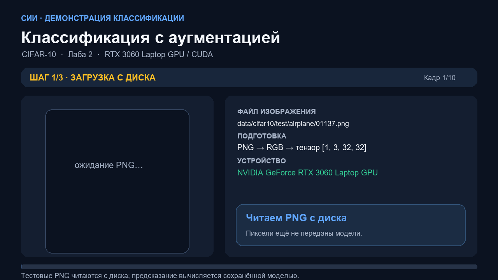
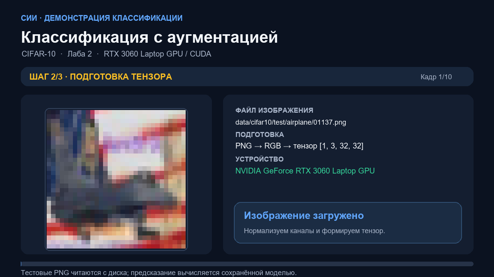
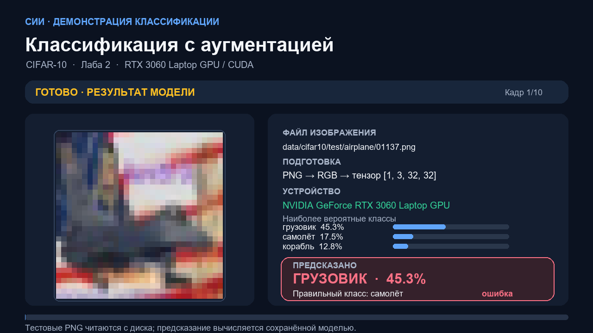

# Отчёт по лабораторной работе 2

**Выполнил:** студент группы ИВТИИбд-41 Валиуллов Р.Р.

## Тема и цель

**Аугментация данных для повышения качества классификации.** Исследуется, меняет ли случайное преобразование обучающих изображений CIFAR-10 качество той же CNN на исходных тестовых данных.

## Метод

Архитектура, данные, batch size 128, SGD с Nesterov, OneCycleLR и число эпох совпадают с лабораторной 1. Для обучающих изображений применены RandomCrop с паддингом, HorizontalFlip, ColorJitter, поворот до ±10° и RandomErasing. Тестовые изображения не преобразовывались. Число параметров модели — 1 148 874, обучение — 15 эпох на RTX 3060 Laptop GPU с CUDA AMP.

## Результаты

Test accuracy с аугментацией — **0,8950**, без аугментации — **0,8877**. Абсолютный прирост составил **0,0073 (0,73 процентного пункта)**. Средний результат улучшился, но не каждый класс стал точнее: точность для птиц изменилась с 0,850 до 0,848, для лошадей — с 0,912 до 0,903. Наибольший прирост среди классов — у собаки: с 0,813 до 0,835.

| Класс | Без аугментации | С аугментацией |
|---|---:|---:|
| airplane | 0,915 | 0,930 |
| automobile | 0,948 | 0,949 |
| bird | 0,850 | 0,848 |
| cat | 0,774 | 0,779 |
| deer | 0,892 | 0,900 |
| dog | 0,813 | 0,835 |
| frog | 0,917 | 0,922 |
| horse | 0,912 | 0,903 |
| ship | 0,932 | 0,945 |
| truck | 0,924 | 0,939 |
| **Итого accuracy** | **0,8877** | **0,8950** |

Время по эпохам: **14 мин 47 с**. Обработка случайных преобразований делает обучение медленнее, но уменьшает зависимость модели от конкретного положения и вида картинки.

## Визуальные результаты

### Сравнение точности и loss

### Примеры применённых преобразований

### Примеры предсказаний после обучения

## Видео и скриншоты демонстрации

Ролик использует те же 10 PNG-изображений, что и демонстрация лабы 1. Видно чтение с диска, подготовку входного тензора, инференс на CUDA и фактический ответ модели с вероятностями. Показаны все предсказания, в том числе ошибочные. Сцены загрузки и подготовки оформлены как равномерные экранные кадры; значения и метки взяты из реального инференса сохранённой модели. Это презентационная демонстрация пайплайна, а не необработанная запись всего рабочего стола.

[Скачать/открыть видео MP4 (46 секунд)](../медиа/лаба2_загрузка-и-распознавание.mp4)

Для показа на другом компьютере распакуйте пакет целиком и откройте `отчеты/медиа/демо.html` в браузере. Для этого Python и интернет не нужны.

<video controls width="960" poster="../медиа/скриншоты/лаба2/03_предсказание.png"><source src="../медиа/лаба2_загрузка-и-распознавание.mp4" type="video/mp4"></video>

Дополнительные скриншоты этапов загрузки и подготовки: `отчеты/медиа/скриншоты/лаба2/`.

## Вывод

На данном запуске аугментация дала небольшой, но измеримый общий прирост точности. Она лучше сработала для ряда классов, но не улучшила каждый класс, поэтому результат нельзя объяснять только одним преобразованием или считать гарантированным для всех выборок.

## Файлы результата

`lab2/results/` содержит `model.pt`, `metrics.json`, `comparison.png`, `augmentations.png`, `predictions.png`, `confusion_matrix.png` и `history.png`. Журнал — `lab2/train.log`.

