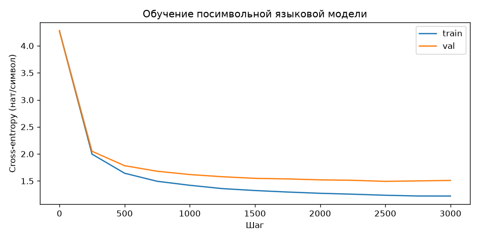

# Отчёт по лабораторной работе 3

**Выполнил:** студент группы ИВТИИбд-41 Валиуллов Р.Р.

## Тема и цель

**Генерация текста нейронной языковой моделью.** Цель — обучить трансформер продолжать заданный текстовый фрагмент, предсказывая символы корпуса.

## Данные и модель

Использован Tiny Shakespeare: англоязычный корпус из 1 115 394 символов, разделённый на обучающую и validation части (90/10). Модель — посимвольный мини-GPT: 4 блока, 4 головы внимания, размер представления 256, контекст 128 символов, 65 символов в словаре, 3 225 665 параметров. Оптимизатор AdamW; warmup 100 шагов, далее cosine schedule. Обучение проходило на RTX 3060 Laptop GPU с CUDA AMP, 3000 шагов.

## Результаты

Лучший validation loss — **1,493 нат/символ** на шаге 2500; на последнем, 3000-м шаге — 1,511. В начале было 4,281. Небольшой рост на финальном шаге показывает, что продолжение обучения после минимума уже не давало улучшения на отложенном тексте.

При температуре 0,8 получаются реплики персонажей и строки, похожие по форме на пьесу, но грамматика и сюжетная логика местами нарушены. Это ожидаемый предел небольшой посимвольной модели.

> O thou art a worthy was soldiers; on the lander.  
> If I, though all the king, enter thus to the people,  
> I rather the stretched last point of the captain,

Время цикла обучения по логу — **8 мин 11 с**; генерация образцов выполнялась после обучения.

## Визуальные результаты

### Кривая функции потерь

### Примеры при разной температуре

Полные образцы при T=0,5 / 0,8 / 1,0 / 1,3 сохранены в [samples.txt](../../lab3/results/samples.txt).

## Вывод

Модель уменьшила ошибку предсказания символов и научилась имитировать стиль диалогов корпуса. Она использует статистические закономерности локального контекста, поэтому генерирует узнаваемую форму текста, но не гарантирует осмысленный сюжет.

## Файлы результата

`lab3/results/` содержит `model.pt`, `loss.png`, `samples.txt` и сводку `metrics.json`. Журнал обучения — `lab3/train.log`.
