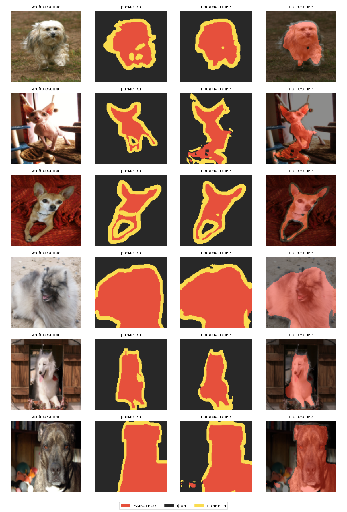
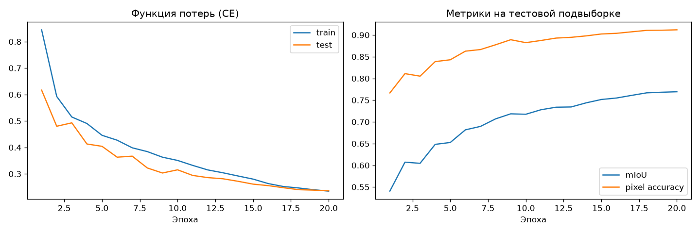

# Отчёт по лабораторной работе 4

**Выполнил:** студент группы ИВТИИбд-41 Валиуллов Р.Р.

## Тема и цель

**Семантическая сегментация изображений.** В отличие от классификации всего изображения, модель присваивает класс каждому пикселю: животное, фон или граница.

## Данные и модель

Использован Oxford-IIIT Pet: 3680 обучающих и 3669 тестовых фотографий кошек и собак с trimap-разметкой. Изображения и маски масштабированы до 128×128; маски обработаны nearest-neighbor, чтобы сохранить дискретные классы. Обучающие геометрические преобразования применялись одинаково к изображению и маске.

Модель — U-Net с 7 763 107 параметрами (`base=32`). Функция потерь — Cross-Entropy + Dice loss, оптимизатор AdamW, OneCycleLR, AMP на CUDA. Обучение — 20 эпох, batch size 16, lr=0,001. На Windows использован `workers=0`: запуск с четырьмя worker-процессами не показывал прогресс.

## Результаты

На полном тестовом наборе получено:

| Метрика | Результат |
|---|---:|
| Pixel accuracy | **0,9127** |
| IoU животного | **0,8378** |
| IoU фона | **0,9138** |
| IoU границы | **0,5590** |
| mIoU | **0,7702** |
| Число параметров | 7 763 107 |

Самый высокий IoU у фона, затем у животного; граница остаётся сложнейшим классом. Она занимает мало пикселей и не всегда однозначна даже в исходной trimap-разметке. Среднее mIoU не позволяет высокой точности на фоне полностью скрыть более слабое качество границы.

Время эпох по журналу — **24 мин 53 с**; итоговая оценка по всему тестовому набору и построение графиков выполнялись дополнительно.

## Визуальные результаты

### Изображение, эталонная маска, предсказание и наложение

### Динамика loss, pixel accuracy и mIoU

## Вывод

U-Net выделяет форму животного и в основном воспроизводит границу объекта. Показатель mIoU 0,7702 согласуется с визуальными примерами: маски содержательно правильны, но детали контура и мелкие участки границы иногда теряются.

## Файлы результата

`lab4/results/` содержит `model.pt`, `metrics.json`, `examples.png` и `history.png`. Журнал обучения — `lab4/train.log`.
